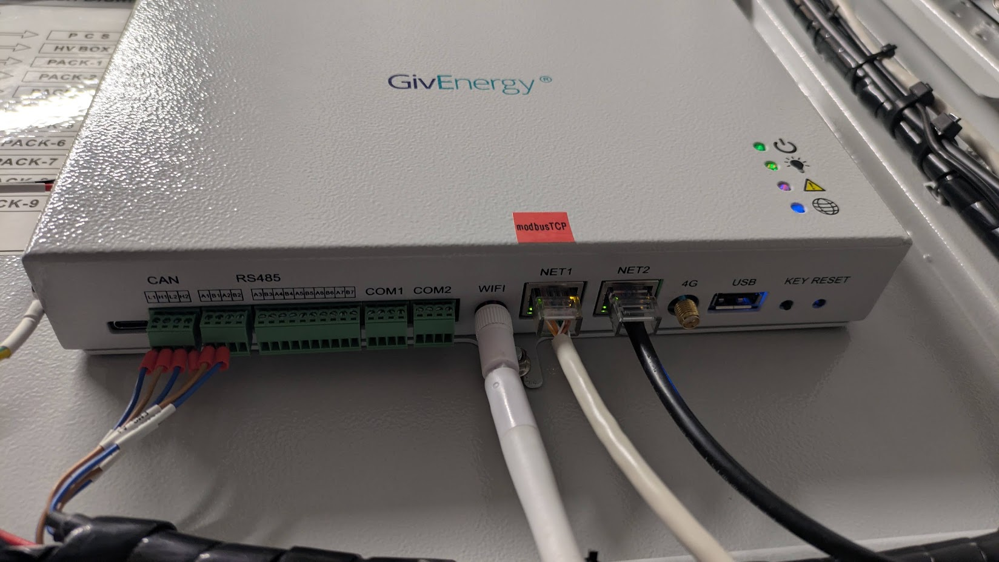

# givenergy-commerical-modbus-tcp
Read data via Modbus TCP from GivEnergy Commercial AIO battery and post to [emoncms.org](https://emoncms.org). 

Tested on GivEnergy Commercial All-In-One 69kWh using a RaspberryPi


# Connections

- Modbus TCP on NET1 (NET2 is used for cloud connection) 
- NET1 Fixed IP of: `192.168.2.230`
- Default slave address `0x11`

Connect NET1 directly to Pi's Etherent connection, then setup the Pi to have an address in the same range: 

```
sudo nmcli connection modify "Wired connection 1" ipv4.addresses 192.168.2.10/24
sudo nmcli connection modify "Wired connection 1" ipv4.method manual
sudo nmcli connection up "Wired connection 1"
```
Check:

```
eth0: flags=4163<UP,BROADCAST,RUNNING,MULTICAST>  mtu 1500
        inet 192.168.2.10  netmask 255.255.255.0  broadcast 192.168.2.255
        inet6 fe80::b092:5ff2:5dbc:c4b3  prefixlen 64  scopeid 0x20<link>
        ether xxxxxxxxxx  txqueuelen 1000  (Ethernet)
        RX packets 378  bytes 49718 (48.5 KiB)
        RX errors 0  dropped 0  overruns 0  frame 0
        TX packets 424  bytes 33120 (32.3 KiB)
        TX errors 0  dropped 0 overruns 0  carrier 0  collisions 0
```
Test for ping: 
```
ping 192.168.2.230
PING 192.168.2.230 (192.168.2.230) 56(84) bytes of data.
64 bytes from 192.168.2.230: icmp_seq=1 ttl=64 time=0.680 ms
```



# Install 

```
sudo cp givenergy-emoncms.env.example /etc/default/givenergy-emoncms
sudo chmod 600 /etc/default/givenergy-emoncms
sudo cp givenergy-emoncms.service /etc/systemd/system
sudo systemctl daemon-reload
sudo systemctl enable --now givenergy-emoncms
journalctl -u givenergy-emoncms -f
```


# Modbus registers 

This script in this repo only reads data, but control should be possible. 

*Format for time is decimal. Eg 23:59 is 2359 0500 is 500*

### Serial number

Read register 13-17 Add them together as a string. You should get the serial number WORKING, see example script. 

### Discharge

Discharge Enable - 59 
Start 1 - 56 
End 1 - 57

### Charge

AC Charge Schedule Enable/Disable: 96 
Start time: 94 e.g 9am is 900
End Time: 95 e.g 2pm is 1400

### SOC Target

Charge target Soc 1 - 242


### Peak Shaving 

Peak shaving enable 20002
Peak shaving value 20050
Valley filling 20051

### Read Data

**Function code 4**

42 Consumption Power (signed 0.1kW)

59 Avg SoC
52 battery total power
50 battery voltage
42 Building usage power (Signed 0.1kw)
45-46 export energy
44 import today
35 export today
32-33 import total
30 grid power
21 grid export today
22 grid export today
18 PV1 power
20 pv2 power
16 grid PF
13 grid frequency
10,11,12 grid current
5,6,7 grid voltage

Read registers 0 to 59